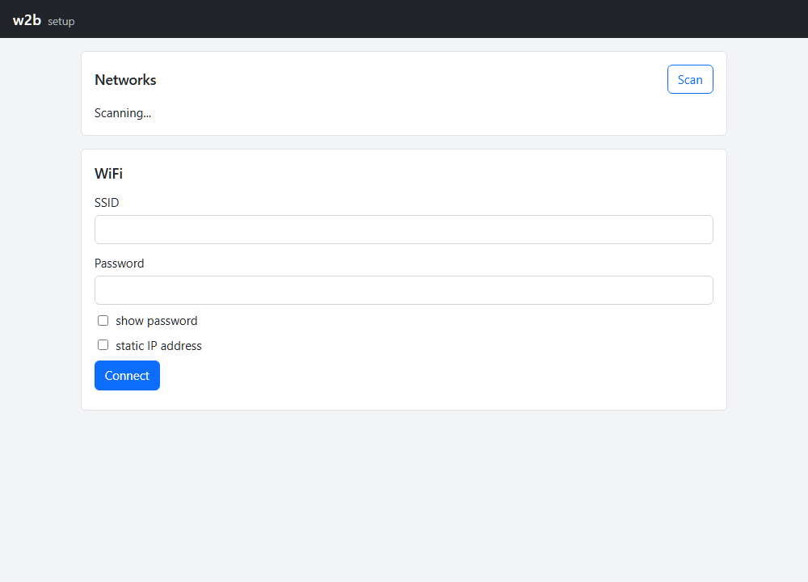
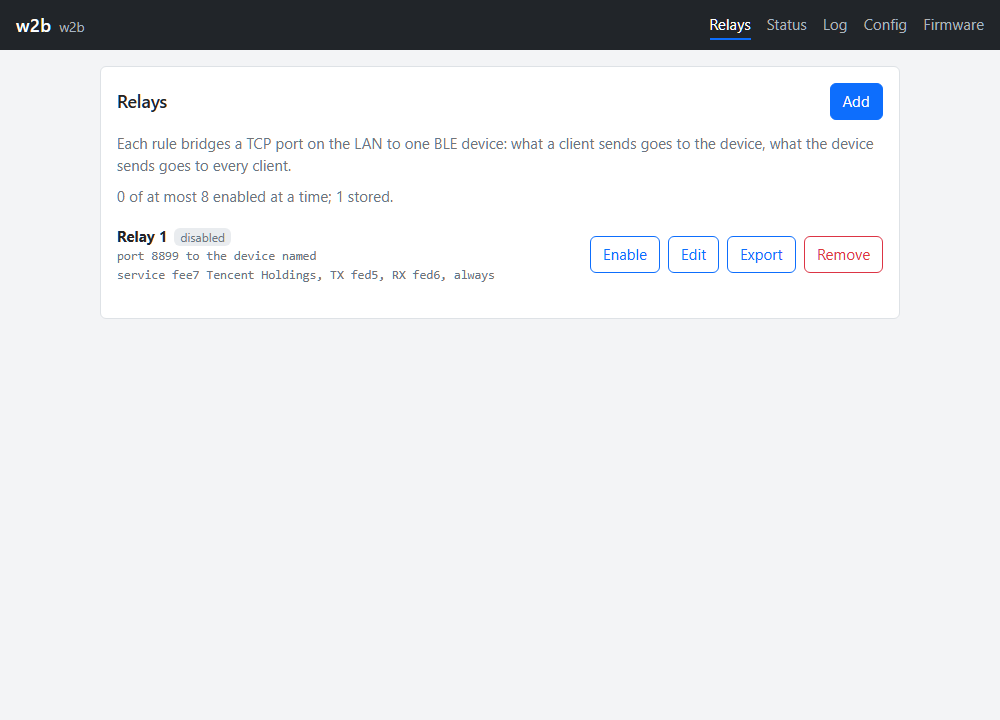
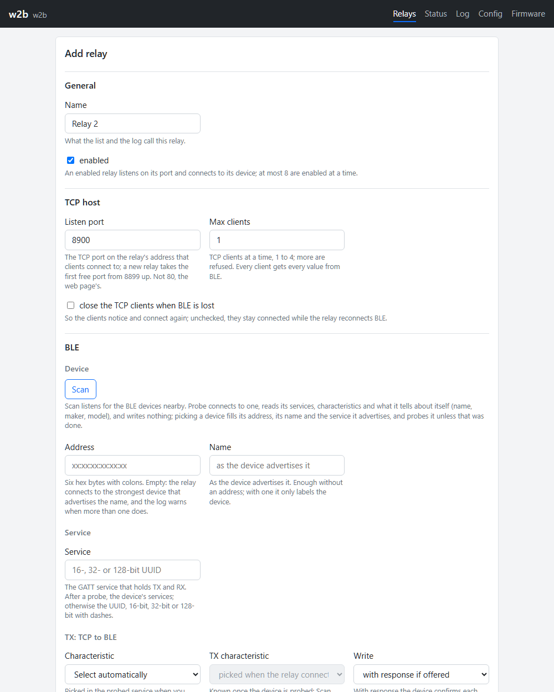
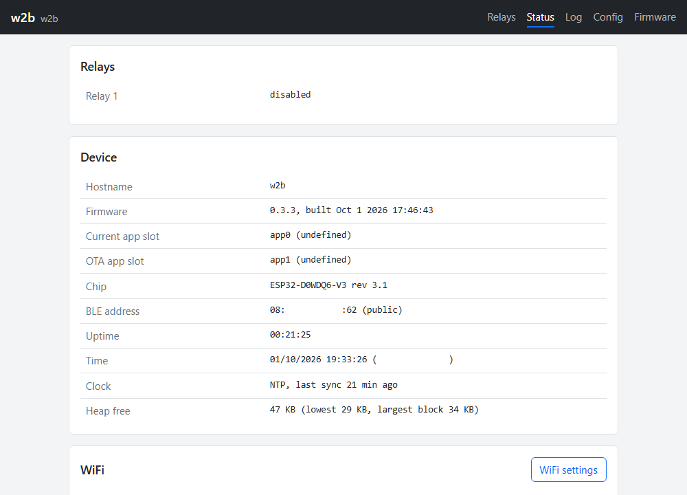
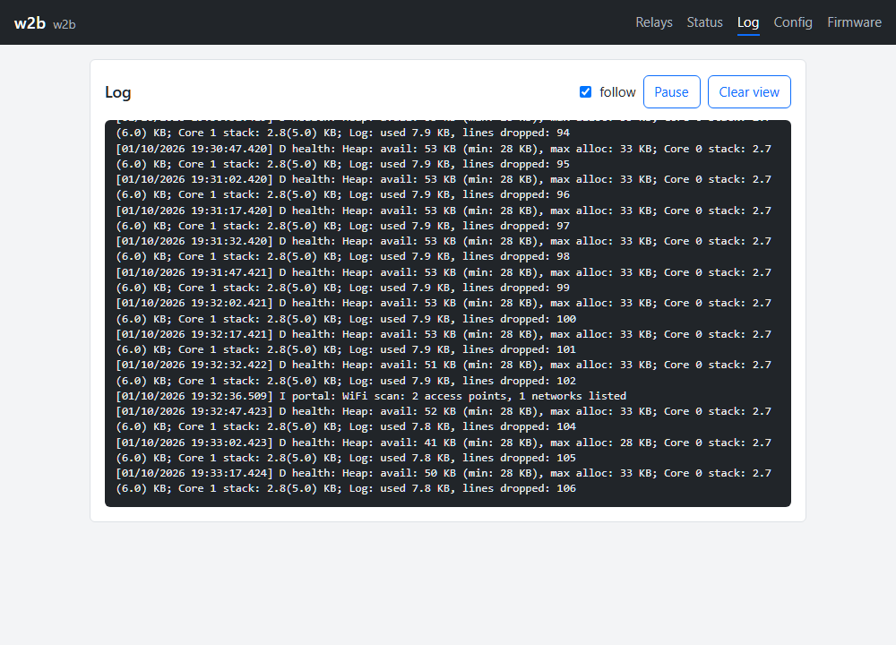
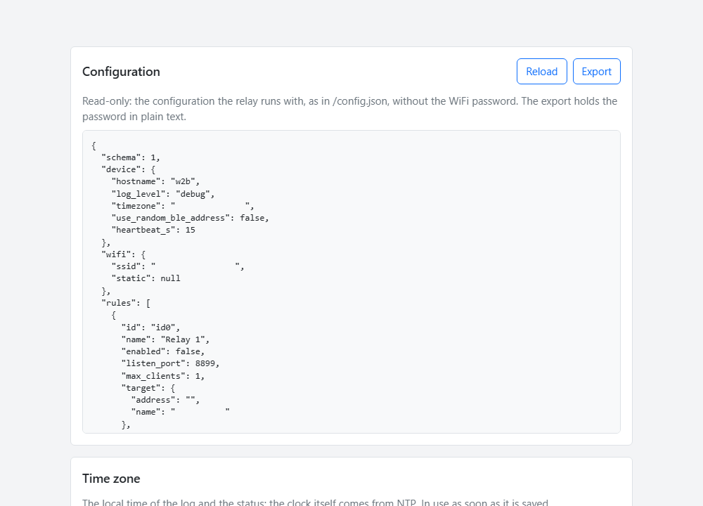
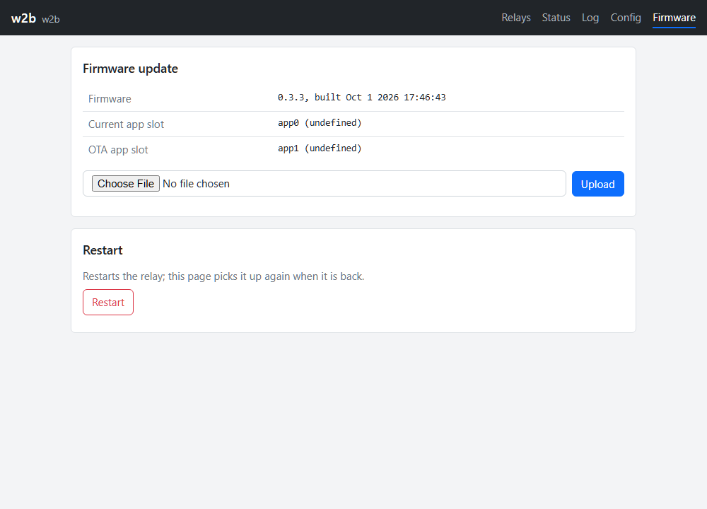

# w2b: a WiFi to Bluetooth LE relay for the ESP32

Firmware that turns a classic ESP32 board into a bridge between your network and
Bluetooth Low Energy devices. A program on your LAN opens a plain TCP connection
to the relay; the relay writes every byte it gets to a BLE device and sends back
everything the device notifies or indicates. It does not understand the bytes.
It carries them.

Typical use: a device that only talks over BLE, and software on a server or a
home automation box that only talks TCP.

## What it can do

- Bridge up to 8 BLE devices at a time, one TCP port each. Several ports to one
  device work too, on different characteristics of it.
- Each bridge is a *rule*, made in the web page: scan for the device, let the
  relay read its GATT table, pick the service and the two characteristics, or
  let the page pick them for you.
- Up to 4 TCP clients on one rule. Every client gets everything the device
  sends; what a client sends goes to the device as whole packets, one at a
  time, so two clients never mix their bytes.
- Connect on demand, the BLE link coming up with the first client and going down
  a few seconds after the last one left, or keep it up always.
- Write with or without response, notifications and indications, MTU up to
  255, longer frames chunked or sent as one long write, your choice per rule.
- A web page for everything: rules, status, log, configuration export and
  import, firmware update over the air. The relay announces itself as
  `w2b.local`.
- First setup over its own WiFi access point, no serial cable needed after the
  first flash.
- Runs on a plain ESP32 with 4 MB flash, no PSRAM.

## What it does not do

- It knows no protocol. No parsing, no filtering, no reassembly. Your client
  must frame its own messages, and it sees the device's bytes exactly as they
  came, in pieces of the device's choosing.
- No access control on the TCP ports: anyone on your LAN can connect. Keep the
  relay on a network you trust.
- It is a central only. It connects to devices; nothing connects to it over
  BLE.
- The speed is BLE's. One link carries a few kilobytes a second, and a request
  that waits for its reply is the kind of traffic it is made for. Ten clients
  flooding one device will see their replies queue, and the relay will drop
  what it cannot carry and count it.

## Using it

### 1. Setup

Flash the firmware (see below) and power the board. It opens an access point
named `w2b-setup`. Join it with a phone or a laptop; the setup page opens by
itself, or at `http://192.168.4.1/`. Pick your network, type the password,
press Connect. The board joins your LAN and the access point goes away. If it
cannot join, the access point comes back and the page tells you why.



### 2. Make a rule

Open `http://w2b.local/`. The first view lists the rules. Press **Add**.



The form has help under every field. The short version:

- **Listen port**: the TCP port your program will connect to. **Max clients**:
  how many at once.
- **Device**: press **Scan**, pick the device from the list. The page fills its
  address and name and reads its GATT table.
- **Service, TX, RX**: with the table read, these are lists. TX is the
  characteristic the relay writes your bytes to, RX the one it subscribes to
  for the device's bytes. *Select automatically* picks the obvious ones when
  the device offers one of each; check the result before you save.
- **Connection**: on demand or always, and how long the link stays after the
  last client left.



Save, then **Enable**. The status column shows the link: searching,
connecting, up. Now point your program at `w2b.local:<port>`.

### 3. Watch it

**Status** shows the device, the WiFi link, the clock and every rule's link
with its counters: frames and bytes each way, drops, reconnects.



**Log** follows the relay's log live. A rule with **hexdump** on prints every
packet it carries, which is the easiest way to see what your device really
sends.



**Config** shows the running configuration and exports or imports it as a
file; a rule can be exported alone. **Firmware** uploads a new build over the
air and restarts; an image that does not come up rolls back to the previous
one.





### From the command line

Everything the page does is a JSON API. A few examples:

```
curl http://w2b.local/api/status
curl http://w2b.local/api/rules
curl http://w2b.local/api/log
curl -OJ http://w2b.local/api/config/export
curl -F "firmware=@firmware.bin" http://w2b.local/api/ota
```

## How it works

- One BLE connection per device, shared by all rules that point at it. The
  controller allows 9 connections; one is kept for the page's probe, so 8
  rules can be enabled at a time.
- Two threads. The relay thread, on its own core, runs the BLE state machines
  and the TCP servers on plain non-blocking sockets. The other core runs the
  radio stacks, the web server, WiFi supervision, time and housekeeping.
  Nothing in the relay waits on anything else.
- A client's bytes collect in a 1 KB buffer and go to the device as packets,
  closed after a short silence or at the MTU. The device's frames go into a
  1 KB ring per rule and from there to every client. A client that sends
  faster than the link carries loses the excess, counted in its rule's
  status; a client that stops answering is reset after about ten seconds; one
  that stops reading is closed after fifteen.
- The configuration is one JSON file on the board's flash, written whole and
  swapped in, so a power cut during a save keeps the old one. The web pages
  are built into the firmware image, so page and API always match.
- Memory is the limit on a classic ESP32: about 60 KB of heap is free with
  the stacks up. A rule costs about 1.5 KB, an idle client the same, a busy
  one about 3.6 KB. Eleven heavy clients on one device have run without a
  restart; the plan caps clients at 8 in all.

## Building

The project is a [PlatformIO](https://platformio.org/) project: Arduino core
3.x on ESP-IDF 5.x through the pioarduino platform, NimBLE-Arduino for BLE,
ESPAsyncWebServer for the web. Two environments: `TZT-ESP32-Lite`, the
firmware for a LOLIN32 Lite style board, and `native`, the host build of the
platform-independent code with its unit tests (needs `g++` on the path).

```
pio run                                        # both environments
pio run -e TZT-ESP32-Lite -t upload --upload-port COM5
pio device monitor -p COM5 -b 115200
pio test -e native                             # host unit tests
```

The first build downloads the platform, framework and toolchain, about 1 GB,
into the project's own `.pio-core` folder; nothing lands in your global
PlatformIO installation. Later updates go over the air from the Firmware view
or with the `curl` line above.

The board environment sets the flash to 80 MHz QIO; a serial upload applies
it. Another ESP32 board gets its own environment in `platformio.ini`, named
after the board, with its LED pin and polarity as build flags.

### Where things are

```
src/main.cpp     the firmware's entry point: the modules and their schedules
include/         compile-time defaults (BuildConfig.h)
lib/core         interfaces and the scheduler's logic
lib/config       the configuration classes and the store
lib/relay        the relay's platform-independent parts: buffers, packets, rule status
lib/ble          BLE value classes: addresses, UUIDs, scan results, GATT tables
lib/wifi         WiFi supervision and roaming over a radio interface
lib/esp32        the Arduino and FreeRTOS glue: threads, BLE engine, TCP server, WiFi radio
lib/web          everything that serves HTTP
web/             the pages, built into the image
test/            host unit tests, and in test/fixtures the end-to-end tests run from a laptop
```

The platform-independent modules are tested on the host; the BLE engine and
the TCP server are tested end to end against a laptop acting as a BLE
peripheral (`test/fixtures/integration_test.py`), and a stress test climbs a
ladder of clients to find where the memory ends.

## License

MIT, see [LICENSE](LICENSE). The libraries the firmware is built with keep
their own licenses.
